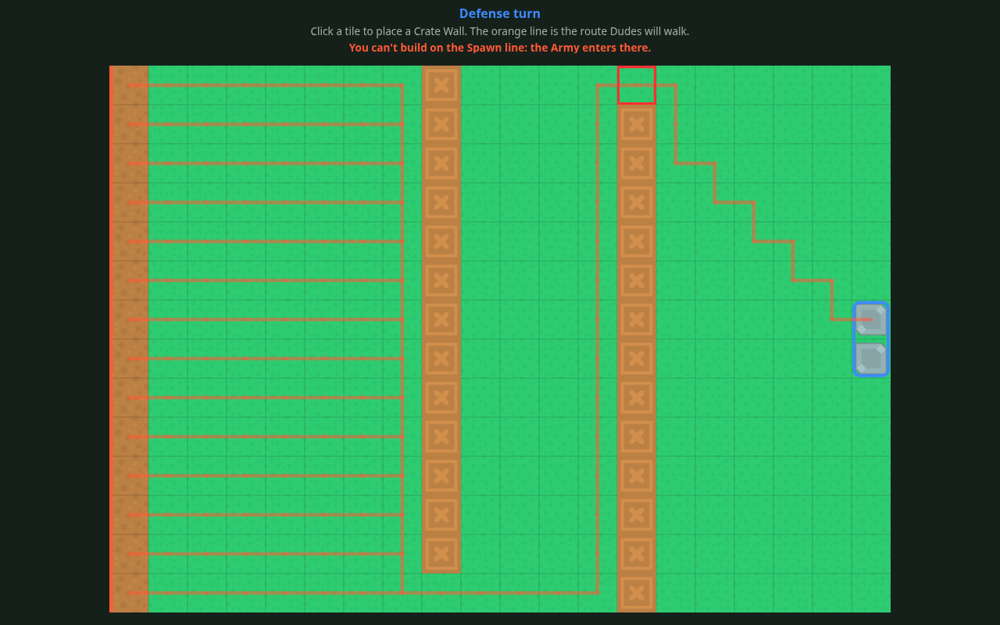

# Against All TOD

A solo Tower Offense Defense browser game: build a Maze, then switch sides and try to break it, on a Board that never resets. A demo for testing whether the idea is fun before it becomes a Steam game. It will be played at `https://rickphobia.com/ai-projects/against-all-tod/` and on itch.io.

## Status

`in progress`: building the Maze. The page draws the 20×14 Board with the Spawn line on the left column and the Goal on the right edge. Click or tap a tile to place a Crate Wall, and click, tap or hover a Piece to see what it does. Scroll or pinch to zoom, drag to pan; a phone held upright asks to be turned to landscape. the route Dudes will walk is drawn from every Spawn line tile and redrawn after each placement, and a placement that would seal the Goal off is refused with a message. There are no Dudes, gold or Rounds yet; they come in the next tickets (`docs/tickets/`). `docs/spec.md` describes the whole demo.



## Requirements

- Node.js 22.22.0 (the version in `.nvmrc`; `nvm use` picks it up) and npm
- A browser with JavaScript; WebGL is used when available (PixiJS falls back to WebGPU or a plain canvas)
- `zip`, only for making the itch.io upload

No accounts or API keys.

## Setup

```bash
cd projects/against-all-tod
npm ci
cp .env.example .env   # the example values work as they are
```

## Run

```bash
npm run dev       # dev server with reload, at the URL it prints
npm run build     # static build in dist/
npm run preview   # serve dist/ to check the build
npm run itch-zip  # build and zip for itch.io: itch/against-all-tod-<commit>.zip
```

## Test

```bash
npm run check     # lint, format check, type check and unit tests: what CI runs
npm run test      # unit tests only
npm run format    # fix formatting
```

CI (`.github/workflows/against-all-tod.yml`) runs `npm run check`, the build and `shellcheck` on the deploy and zip scripts on every push that touches this project.

## Configuration

Read from `.env` at build time (Vite bakes `VITE_*` variables into the page) and validated in `src/config.ts`. `vite.config.ts` validates them too, so a bad value fails the build instead of shipping a blank page.

| Variable | Required | What it does |
|----------|----------|--------------|
| `VITE_BASE_PATH` | yes | Where the site is served from. `./` (the default) works from any folder, so the live site, PR previews and itch.io use the same build. An absolute path must start and end with `/`. |
| `VITE_DEBUG` | yes | `true` logs at debug level in the browser console; `false` logs info and above. |
| `VITE_DEFAULT_SEED` | yes | Seed for a new Run when the URL gives none, a whole number from 0 to 4294967295. Used once Runs exist. |
| `VITE_BUILD_VERSION` | no | Names the build in the start-up log. `deploy/update-site.sh` and `npm run itch-zip` set it to the commit, `scripts/try-pr.sh` to the PR and commit; otherwise `dev`. |

The deploy scripts read their own `AGAINST_ALL_TOD_*` variables from the shell; see "Deploy".

## How it works

The spec (`docs/spec.md`, "Modules") plans pure rule modules (maze, battle, run, economy and so on) with no DOM or PixiJS, and adapters around them. The skeleton has the first pieces:

- `src/main.ts` is the entrypoint: it loads the config, makes the logger, starts the renderer and, for now, wires Board clicks to the maze rules (the run module takes that over when Rounds exist). If anything throws, it logs the error and shows the start-up error screen.
- `src/maze/board.ts` is the Board's layout as data: 20 columns × 14 rows, the Spawn line on column 0, and the Goal on the right column in the middle two rows (6 and 7). Pure, so the maze and battle rules can share it.
- `src/maze/maze.ts` holds the placed Pieces and answers "may this Piece go here?" with a typed refusal (`off-board`, `spawn-line`, `goal`, `tile-taken`, `seals-goal`). A Maze is immutable and carries its route, recomputed on each placement.
- `src/maze/route.ts` is the route: one breadth-first direction field from the Goal over walkable tiles, so every Dude on a tile shares one step. Equally short steps are broken toward the Goal's centre, so routes cut diagonally toward the Goal rather than run along an edge.
- `src/catalog/pieces.ts` holds every Piece's tuning numbers (price, health, whether it blocks Dudes). Tests read numbers from it.
- `src/adapters/renderer/` draws with PixiJS. `game-renderer.ts` starts PixiJS in the page and keeps the Board scaled to fit the window (`fit-to-view.ts`); `board-view.ts` builds the Board from Kenney tiles, with faint lines between tiles, a stripe in the attack colour on the Spawn line and the Goal framed in the defense colour. `board-textures.ts` loads the tiles. `pieces-view.ts` draws the Pieces, `route-view.ts` the route preview and `placement-cursor.ts` the tile under the mouse (a ghost Piece, or a red frame where it can't go). `camera.ts` is the zoom and pan: pure maths for screen-to-Board conversion and clamping, so the Board can't be zoomed out past fitting the window, in further than 2.5×, or dragged off screen.
- `src/adapters/input/board-pointer.ts` turns mouse, wheel and touch events on the canvas into hovers, taps, pans and pinch zooms. A press that moves more than a few pixels, or gains a second finger, pans or zooms and never places.
- `src/ui/hud.ts` is the band above the Board: the turn, what to do, and why a placement was refused.
- `src/ui/piece-info.ts` is the panel naming the Piece under the mouse or last tapped, with its one-line description.
- `src/ui/device.ts` shows the turn-your-device screen while a touch device is held upright.
- `src/ui/startup-error-screen.ts` shows why the game could not start, in plain DOM.

## Folder layout

```
src/
  main.ts              entrypoint: wires config, logger, renderer and the maze rules
  config.ts            reads and validates VITE_* settings
  logger.ts            levelled logger over the browser console
  catalog/             tuning numbers for every Piece
  maze/                the Board's layout, Piece placement and the route
  adapters/input/      mouse, wheel and touch to taps, pans and zooms
  adapters/renderer/   PixiJS: draws the Board, Pieces and route, fits it to the window
  ui/                  DOM: the HUD, piece info, turn-your-device and start-up error screens
assets/                Kenney art, with its licence
tests/                 mirrors src/ (Vitest)
scripts/itch-zip.sh    builds and zips the game for itch.io
deploy/                update-site.sh and rollback.sh for the Beelink
docs/                  spec, tickets, decisions, screenshots
```

## Debugging

- Logs go to the browser console, prefixed `[against-all-tod]`. Start-up logs the build version and Board size at `info`, then `renderer ready` (with `webgl`, `webgpu` or `canvas`) and `Board drawn`. A refused placement logs `placement refused` at `info` with the tile and the reason; each placed Piece logs `Piece placed` at `debug`.
- Add `?debug=1` to the page URL for debug-level logs without a rebuild (it also logs the config), or set `VITE_DEBUG=true` and rebuild.
- A `WebGL is off or unavailable` warning means the browser fell back to a plain canvas: the game still draws but will be slower once there are hundreds of Dudes. Check `chrome://gpu` or `about:support`.
- If start-up fails, the page shows "Against All TOD could not start" with the reason, and the console has a `start-up failed` error with its `kind` (`ConfigError`, `RendererStartError` or another).
- A blank page with no log usually means the JS bundle didn't load: check the network tab for a 404 and that `VITE_BASE_PATH` matches where the page is served.

## Deploy

The game is a static site, served at `https://rickphobia.com/ai-projects/against-all-tod/` by nginx in Docker on the Beelink, with `~/homelab/html` as the site root. GitHub can't reach the home network, so the server pulls: you run one script there.

`deploy/update-site.sh` fetches `main` into `~/homelab/dev/ai_slops`, builds in a pinned `node` Docker image (no Node install needed on the server), copies the result to `~/homelab/html/ai-projects/against-all-tod.new`, then renames it into place. The old build stays as `against-all-tod.previous`. If any step fails, the script exits non-zero, names the step, and the live site stays as it was. If `main` hasn't moved since the last deploy, it does nothing.

### First-time setup (on the Beelink)

Needs `git`, `docker` (your user can run it without sudo) and `flock` (part of `util-linux`, already on Ubuntu). The clone is shared with the other projects, so skip it if `~/homelab/dev/ai_slops` exists.

```bash
mkdir -p ~/homelab/dev && git clone https://github.com/rickphobia/ai_slops.git ~/homelab/dev/ai_slops
~/homelab/dev/ai_slops/projects/against-all-tod/deploy/update-site.sh
```

No nginx change is needed: `/ai-projects/` is already served from `~/homelab/html/ai-projects/` (see pawn-swarm's README).

### Update

```bash
~/homelab/dev/ai_slops/projects/against-all-tod/deploy/update-site.sh
```

To rebuild even though `main` hasn't changed: `AGAINST_ALL_TOD_FORCE=1 ~/homelab/dev/ai_slops/projects/against-all-tod/deploy/update-site.sh`.

Settings (all optional, shown with defaults in `.env.example`) are environment variables: `AGAINST_ALL_TOD_REPO_URL`, `AGAINST_ALL_TOD_BRANCH`, `AGAINST_ALL_TOD_SRC_DIR`, `AGAINST_ALL_TOD_SITE_ROOT`, `AGAINST_ALL_TOD_SITE_SUBPATH`, `AGAINST_ALL_TOD_NODE_IMAGE`, `AGAINST_ALL_TOD_FORCE`. The scripts do not read `.env`.

### Roll back

```bash
~/homelab/dev/ai_slops/projects/against-all-tod/deploy/rollback.sh
```

Swaps `against-all-tod` and `against-all-tod.previous`. Run it again to undo. The next `update-site.sh` run puts the latest `main` back.

### Check that it worked

```bash
curl -I https://rickphobia.com/ai-projects/against-all-tod/   # expect HTTP 200
cat ~/homelab/dev/against-all-tod.deployed-commit            # the commit that is live
```

Then open the URL: the console's `starting` line shows the same commit.

### itch.io

`npm run itch-zip` builds with relative paths and writes `itch/against-all-tod-<commit>.zip` with `index.html` at its root. On the itch.io project page, set "Kind of project" to HTML, upload the zip and tick "This file will be played in the browser". The `itch/` folder is not committed.

### PR previews

`scripts/try-pr.sh <PR number>` builds a PR on the Beelink and serves it; the preview timer does this for every open PR (see "Previews on the Beelink" in `docs/workflow.md`).

## Credits

Art from [Kenney](https://kenney.nl), CC0 (public domain); the licence ships in `assets/`:

- [Tower Defense (top-down)](https://kenney.nl/assets/tower-defense-top-down): grass, dirt and stone base tiles (`assets/kenney-tower-defense-top-down/`)

## Decisions

See `docs/decisions/` for why things are the way they are.
