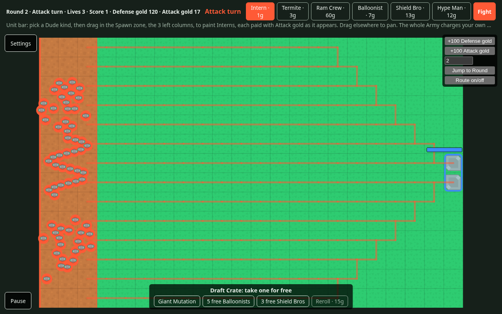

# Against All TOD

A solo Tower Offense Defense browser game: build a Maze, then switch sides and try to break it, on a Board that never resets. A demo for testing whether the idea is fun before it becomes a Steam game. It will be played at `https://rickphobia.com/ai-projects/against-all-tod/` and on itch.io.

## Status

`in progress`: a full solo Run. The page draws the 22×14 Board with the Spawn zone (the 3 left columns, striped in the attack colour, where nothing can be built) and the Goal on the right edge. Round 1 is a Defense turn: pick Crate Wall or Sniper Nest from the shop (each button shows its price) and click or tap tiles to buy and place them with Defense gold, then press Fight to watch a game-made Army of 40 Interns charge from the Spawn zone, all at once. Every won Round switches sides: on an Attack turn the unit bar lists the Dude kinds on sale (Intern, Termite, Ram Crew, Balloonist, Shield Bro, Hype Man) with their price per Dude; tap one as the brush and drag inside the Spawn zone to paint single Dudes along your stroke, each paid with Attack gold as it appears. Each Dude keeps a little room around it by size (a full zone holds about 500 Interns), holding still adds nothing, a drag that starts outside the zone pans, and a second finger turns a paint into a pinch. The Eraser on the unit bar removes every Dude you drag it over: a Dude painted this Round is Erased for its price back (or back into the crate gift it came from), and one from an earlier Round is Dismissed for nothing; while the Eraser is chosen, those older Dudes are dimmed. The Army is every Dude painted so far, back where it was painted every Round, and when the battle starts the whole Army charges the Maze you built at once. You have 3 Lives; a lost Round costs one and Rewinds the Board, Army and both wallets to the start of that Round, plus bonus gold for the side you played. Defense gold comes from kills and the Goal health left after a won Defense turn; Attack gold from Dudes reaching the Goal and Dudes still alive when it breaks. A won Round keeps what the battle earned. The top bar shows icon chips for ❤ Lives, 🛡 Defense gold, ⚔ Attack gold, ★ Score (Rounds won) and the Round, beside the turn in the side's colour, above chunky buttons that press in (at least 44 px tall on touch; a long shop scrolls sideways while Take back and Fight stay in reach); at zero Lives the end screen shows the Score against the best Score, what the Run Unlocked and the next Unlock with the best Score it needs, and starts a new Run in one click. Best Score milestones Unlock new Pieces and Dude kinds for later Runs: Sapper (5), Bouncer (10), Mole (15), Decoy Goal (20), Streaker (25); crates offer only what is Unlocked, and the unit bar sells Unlocked Dude kinds. A player's first Run shows a one-line hint in Rounds 1–3 (mazing, switching sides, the Settings menu). Click, tap or hover a Piece to see what it does; scroll or pinch to zoom, drag to pan; a phone held upright asks to be turned to landscape. A placement that would seal the Goal off is refused with a message. Watch at 1x, 2x or 4x. The Run, best Score (and so the Unlocks) and whether the first Run is over are saved in the browser after every action, so a refresh or closed tab picks up where you were (a reload mid-battle restarts that battle; a save that can't be read gives a fresh start with a short message). Each Round opens a Draft Crate for the side being played along the bottom of the Board: 3 random items from that side's pool (Pieces on defense; gifts of free Dudes and Mutations on attack), one taken for free, or the whole crate rerolled for that side's gold. Defense crates also offer the Turnstile (a wall with two arms that turns 90° every 5 seconds, flipping the route), the Lighthouse (a sweeping beam that hurts Dudes) the Siren (stuns Dudes near it every few seconds), the Tax Booth (a floor Piece: each Dude walking over it moves Attack gold to Defense gold), the Grinder (a floor Piece that kills Interns, Termites and Streakers outright for double gold, hurts bigger Dudes, and jams for 3 seconds after each kill), once Unlocked, the Bouncer (throws the first Dude it touches back to the spot it started the battle on, then waits 6 seconds) and the Decoy Goal (walkers go for it first; each hits it and vanishes without earning gold, until it breaks for that battle); the shop sells only Crate Walls and Sniper Nests so far. Attack crates also offer Wall-breakers, the only Dudes that damage Pieces: Termites chew slowly through the wall in their way, a Ram Crew smashes a wall or tower in one hit and slows as its 4 carriers fall, and a Sapper runs to the nearest wall and blows up himself and the wall. Wall-breakers head for the wall that matters (through it, when the way round is long); a destroyed Piece is gone, the other Dudes re-route through the hole, each one pays Attack gold, and it stays gone if the Round is won (a Rewind puts it back). A taken Piece is placed for free next; a taken gift (20 free Interns, 10 Termites, 1 Ram Crew…, the Sapper, Mole and Streaker once Unlocked) is painted first when you paint that kind, its count shown on its kind in the unit bar, and what is left is lost at the end of the Round; a taken Mutation changes every Dude in the Army for the rest of the Run, and Mutations stack: Split (a dying Dude becomes two halves), Giant (every Nth Dude of each kind in paint order, 1 in 20 Interns and every Ram Crew, has 5× health at half speed, drawn bigger), Explosive Shields (every Dude has a small shield that stuns towers within 3 tiles for 1 second when it breaks), Conga Line (each Stroke, the Dudes of one drag, walks single file and shares every hit across its living members), Ghost Mode (a dead Dude walks on for 3 seconds, faded out, where nothing can touch it, and still damages the Goal and pays if it gets there) and Gold Teeth (double Attack gold for reaching the Goal). A Rewind opens the same crate again. From Round 2 each Round has a random Curse, shown as a chip on the top bar (named, with its effect for screen readers) and announced with its effect as building starts; it lasts that Round only, and a Rewind keeps the same one. Four hurt the defense: Rust (towers fire 20% slower), Power Cut (Lighthouses and Sirens off, so they light nothing in the dark either), Earthquake (one random Piece moves one tile for the battle, never sealing the Goal; the Board keeps it where it was) and Audit (Tax Booths pay nothing). Four hurt the attack: Traffic Jam (the Army sets off one Dude at a time, in paint order), Mud (Dudes 20% slower), Stage Fright (Hype Men don't work) and Union Break (Wall-breakers can't damage Pieces and walk round the walls like everyone else). Every fifth Round (5, 10, 15…) is a Boss Round, named on a chip on the top bar and announced as building starts; the boss is there for that battle only, and comes back on a Rewind. On a Defense turn The Landlord joins the attacking Army: a huge Dude with 1500 health who ignores Decoy Goals and evicts the Piece nearest him every 10 tiles he walks (an eviction pays nobody and lasts for that battle only: the Board gets the Piece back afterwards). On an Attack turn The HR Department, a purple tower, stands on the free tile nearest the Goal and sends one Wall-breaker in range back to where it stood in the Spawn zone every 2 seconds. Winning a Boss Round opens a boss crate next Round: 5 items, 2 taken for free (the first can be placed before taking the second), and sometimes one is a free Undo. The Settings button opens the game's own Settings menu, where Brightness, Volume, Window size and Game speed sliders bend the battle: each has a neutral middle and 2 steps each way, and every drag costs the side being played its own gold (double back toward the middle, double again mid-battle). Brightness down darkens the Board and shrinks tower range except on tiles a Lighthouse lights, with Pieces and Dudes glowing in their side colour; Brightness up dazzles and slows Dudes. Volume down hides Dudes from towers until they are close (3 tiles at one step, 2 at two) and really quiets the game; Volume up makes Sirens reach further and Hype Men boost harder. Window size up adds an empty lane along the top and bottom edges of the Board, so Dudes can walk round the Maze (Pieces can be built on a lane, and are crushed when it closes again); Window size down closes Spawn zone rows from the top and bottom and pushes the Dudes standing there into the nearest open row, closer together than painting allows. The Board's frame grows and shrinks with it. Window size moves only between battles, and a drag that would cut the Spawn zone off from the Goal is refused. Game speed up makes Dudes faster and towers slower to reload; down does the opposite. The Pause button stops the battle and opens the honest "Actual volume (we promise)" slider, which sets the real sound level, is saved in the browser and never touches the tricks. Shots, kills, gold, Goal hits and Round ends play Kenney sounds at actual volume × the Volume trick's loudness. A trick stays until moved back or Undone: between battles, a moved slider's Undo button snaps it to the middle, and the side being played pays by picking its own Pieces (tap them; picked ones vanish from the Board until paid or tapped again) or Dudes (drag over them; earlier Rounds included, picked ones dimmed) worth at least the Undo price, which grows with how far the slider stands from the middle; nothing is refunded, and Undoing Window size resizes the Board like a drag. A free Undo skips the payment. A lost Round Rewinds the sliders with everything else. The ↶ Take back button beside Fight (or Ctrl+Z / Cmd+Z) reverses your last move this Round, before the battle, and gives back exactly what it cost: a placed Piece, a whole Stroke (Dudes from a gift go back to the gift), an eraser drag, a crate pick (with the Mutation or free Undo it gave), or a Settings trick dragged before the battle (a Window size drag puts back every Piece and Dude it moved). Each press steps one move further back, as far as the start of the Round; a crate reroll or an Undo is a checkpoint it never goes past, and starting the battle clears it. The button names the move it would reverse, is greyed out when there is none and hidden during a battle, and the message line says what came back. More content comes in the next tickets (`docs/tickets/`). `docs/spec.md` describes the whole demo.



## Requirements

- Node.js 22.22.0 (the version in `.nvmrc`; `nvm use` picks it up) and npm
- A browser with JavaScript; WebGL is used when available (PixiJS falls back to WebGPU or a plain canvas)
- `zip`, only for making the itch.io upload

No accounts or API keys.

## Setup

```bash
cd projects/against-all-tod
npm ci
cp .env.example .env   # the example values work as they are
```

## Run

```bash
npm run dev       # dev server with reload, at the URL it prints
npm run build     # static build in dist/
npm run preview   # serve dist/ to check the build
npm run itch-zip  # build and zip for itch.io: itch/against-all-tod-<commit>.zip
```

## Test

```bash
npm run check     # lint, format check, type check and unit tests: what CI runs
npm run test      # unit tests only
npm run format    # fix formatting
npm run bench     # times the 500-Intern swarm battle headless, in ms per step
npx vitest run tests/balance   # the balance check alone (a minute or two)
```

The balance check (`tests/balance/`) plays whole seeded Runs headless to Round 10 with two simple fixed strategies: the basic Maze buys Sniper Nests on a fixed grid of tiles, the basic Army paints Interns across the Spawn zone, and both take every crate pick and use what it gives. For each seed it checks bounds, not exact results: the basic Army breaks the basic Maze by Round 4, the basic Maze holds a painted Army at least once, and the Run lasts past Round 4. Each seed has its own test file (`seed-N.test.ts`) so Vitest plays them in parallel. A failure prints the Run battle by battle (Round, side, won or lost, Pieces, Dudes, Curse, boss). To see how a retune plays out, add a seed file or call `playRun` and `describeRun` from `tests/balance/play-run.ts` in a scratch test.

The performance target (`docs/spec.md`) is 500 Dudes at 60 fps on a mid-range laptop and at least 30 fps on a mid-range phone. To measure it, run `npm run dev` (or open any build) with `?debug=1&scene=swarm` added to the URL: the swarm debug scene sends 500 Interns at a sample Maze of walls and Sniper Nests at 1x, starts over when the battle ends, and the corner shows the frame rate, the lowest it has been and how many Dudes are on the Board. `npm run bench` checks the battle rules alone, without drawing.

Developer URL options:

- `?seed=<n>` starts a Run with seed `n` (0 to 4294967295); the same seed and the same actions give the same Run. A reload keeps the saved Run while its seed matches.
- `?debug=1` logs at debug level and shows buttons to give 100 gold to either wallet, jump to Round N with the Board as it is, and toggle the route preview.
- To wipe the save, run `localStorage.removeItem("against-all-tod.save")` in the browser console.

CI (`.github/workflows/against-all-tod.yml`) runs `npm run check`, the build and `shellcheck` on the deploy and zip scripts on every push that touches this project.

## Configuration

Read from `.env` at build time (Vite bakes `VITE_*` variables into the page) and validated in `src/config.ts`. `vite.config.ts` validates them too, so a bad value fails the build instead of shipping a blank page.

| Variable | Required | What it does |
|----------|----------|--------------|
| `VITE_BASE_PATH` | yes | Where the site is served from. `./` (the default) works from any folder, so the live site, PR previews and itch.io use the same build. An absolute path must start and end with `/`. |
| `VITE_DEBUG` | yes | `true` logs at debug level in the browser console; `false` logs info and above. |
| `VITE_DEFAULT_SEED` | yes | Seed for the first Run when the URL gives none, a whole number from 0 to 4294967295. Each new Run from the end screen uses the next seed. |
| `VITE_BUILD_VERSION` | no | Names the build in the start-up log. `deploy/update-site.sh` and `npm run itch-zip` set it to the commit, `scripts/try-pr.sh` to the PR and commit; otherwise `dev`. |

The deploy scripts read their own `AGAINST_ALL_TOD_*` variables from the shell; see "Deploy".

## How it works

The spec (`docs/spec.md`, "Modules") plans pure rule modules (maze, battle, run, economy and so on) with no DOM or PixiJS, and adapters around them. The skeleton has the first pieces:

- `src/main.ts` is the entrypoint: it loads the config, makes the logger, starts the renderer and the HUD, and the end screen, and hands them to `src/run-screen.ts`. If anything throws, it logs the error and shows the start-up error screen.
- `src/adapters/storage/save-store.ts` saves the Run as JSON in `localStorage` with a version number after every accepted Run action (including Fight, so the ready-to-fight state is saved; painted Dudes once per Stroke, when the drag ends) and loads it at start-up. Data that isn't JSON, has another version or doesn't fit the rules gives a fresh start and a logged warning; the save itself is never logged. Bump `SAVE_VERSION` when the saved shape changes.
- `src/debug/debug-options.ts` reads `?seed=` and `?debug=1` and holds the debug changes to a Run (give gold, jump to Round N); `debug-panel.ts` draws their buttons.
- `src/run-screen.ts` wires a Run to the screen: Board taps and HUD buttons become Run actions (a refusal is logged and shown), Fight starts the Round's battle, each frame runs the steps the watch clock says are due and hands the state to the renderer, and the winner goes back to the Run.
- `src/run/run.ts` is the Run, a pure state machine: `applyRunAction` takes the state and an action (take from crate, reroll crate, place Piece, paint Dude, erase Dude, drag slider, start battle, battle finished, continue, new Run) and returns the new state or a typed refusal (`wrong-phase`, `wrong-side`, `not-enough-gold`, `not-spawn-zone`, `no-room`, `not-on-sale`, `no-dude`, `no-crate`, `slider-end`, or the Maze's own). `paint-dude` puts one Dude at a spot in tiles with the Stroke the screen took at the start of the drag (`nextStroke`); `erase-dude` removes one Dude by its place in the Army (the screen finds the Dudes under the eraser with `dudesUnder`): Erased for its price back, to gold or to the gift (`fromGift`), if painted this Round, else Dismissed for nothing; the Army (`src/battle/army.ts`) is the list of painted Dudes (kind, spot, Stroke, Round painted) in paint order, with the room check and Round 1's seeded layout of Interns. Round N is Rounds won + 1; odd Rounds are Defense turns, even Rounds Attack turns. Placing a Piece pays from the Defense wallet and painting a Dude from the Attack wallet, never the other. A won Round keeps everything placed plus the gold the battle earned (the `battle-finished` action carries it); a lost one costs a Life and puts back the Board, Army and wallets saved at the start of the Round, plus the Rewind bonus for the side played. A slider dragged between battles moves at once; one dragged mid-battle is kept in `sliderInputs` as a timed input (the step it takes effect from) and folded into the positions when the battle ends, so the battle replays the same from its seed, even after a reload.
- `src/run/take-back.ts` is the Take back history the Run keeps for the current Round (`takeBack` in the state, saved with it): one entry per takeable action, newest last. An entry holds the wallets, crate, free items, Mutations, free Undos and sliders as they stood before the action, plus how it changed the Pieces and the Army (the places of what it added, and what it removed with where it stood), so the `take-back` action reverses it exactly without a whole snapshot per Stroke. Every `paint-dude` with the same Stroke number joins one entry, and every `erase-dude` with the same eraser-drag number (`nextEraserDrag`) another. `reroll-crate`, `undo`, `start-battle` and a new Round clear it; `take-back` is refused with `nothing-to-take-back` when it is empty and `wrong-phase` outside building.
- `src/tricks/tricks.ts` is the Settings tricks' rules: slider positions (-2 to 2), which way helps which side, the price of a drag step by step, the positions at any step of a battle from its start and its inputs, and the Undo price. `src/catalog/tricks.ts` holds the sliders, their prices and the size of each effect.
- `curseOf` in `src/run/run.ts` rolls the Round's Curse from the Round's seed (none in Round 1), worked out rather than saved, so a Rewind and a reload keep it; `battleSetupOf` hands it to the battle. `src/catalog/curses.ts` holds the 8 Curses, the side each hurts and their numbers. `bossOf` works out the Boss Round's boss from the Round the same way (the schedule is in `src/run/boss-rounds.ts`), so the Board and Army the Run keeps never hold it; `src/catalog/bosses.ts` holds the bosses, the Boss Round interval and the boss crate's size, picks and free-Undo chance (The Landlord's body is a Dude kind in `dudes.ts`, The HR Department's a Piece in `pieces.ts`, both marked so no crate or shop offers them).
- `src/run/crate.ts` rolls a Round's Draft Crate from the Round's seed and the reroll count (so a Rewind, which puts rerolls back to zero, offers the same crate), leaving out Mutations the Army has; the Round after a Boss Round gets a boss crate (bigger, more picks, maybe a free Undo). `src/catalog/pools.ts` holds what each side's crates can offer, the crate size and the reroll price; `src/catalog/mutations.ts` the Mutations. The Run keeps the crate with its picks left, the taken Pieces and gifts (with how many Dudes are left) waiting to be placed for free, and the Army's Mutations (in the Rewind snapshot too); `src/ui/crate.ts` draws the crate.
- `src/economy/economy.ts` turns a battle's events and end (winner, Goal health, surviving Dudes) into gold for each wallet: per kill, Goal health bonus, per Dude reaching the Goal, per survivor when the Goal breaks and per Piece a Wall-breaker destroys, each times the Dude kind's `goldValue`, with Gold Teeth doubling the gold for reaching the Goal. `spend` takes gold from one side only. The state is plain data (Pieces as a list, not a Maze) so ticket 08 can save it as it is; `mazeOf` rebuilds the Maze and `battleSetupOf` the Round's battle, with a seed per Round from the Run's seed.
- `src/battle/` is the battle, pure and headless. `battle.ts` starts a battle from a Maze, an Army, a seed and the battle rules, and steps it at a fixed 1/60 s: the whole Army stands in the Spawn zone at step 0, each Dude where it was painted (`armyDudes`, which the renderer also draws while building), and charges at once, towers fire, Lighthouse beams and Siren pulses hit, Dudes walk (unless stunned) along the route of the moment (the Turnstiles' turned route every other 5 seconds) or, for a Wall-breaker with a Piece in its way, hit that Piece, then it checks the end (Goal at zero: attack wins; no Dudes left or 90 s of game time: defense wins). `dudes.ts` walks a Dude along the shared route, `area-effects.ts` sweeps the Lighthouse beams, pulses the Sirens (range scaled by the Volume slider), skipping Dudes underground and flyers unless the beam or stun hits air, and lists the tiles Lighthouses light, `towers.ts` fires the Sniper Nests (biggest Dude in range, then the one closest to the Goal; each step sorts the Dudes by tile, so a tower only looks at the tiles its range reaches), `traps.ts` runs the Tax Booth and Grinder for Dudes stepping onto them, the Bouncer, and the fields walkers follow to a Decoy Goal first, `wall-breakers.ts` picks a Wall-breaker's field (the maze module's `wallBreakerRoutes`: to the Goal with blocking Pieces passable at a high cost, or to the nearest wall for the Sapper), finds the Piece in its way and applies its hit; the battle state keeps its own Maze and Piece health, and a destroyed Piece leaves the Maze (`removePiece`, which works the routes out again), the towers and the effect Pieces. `damage.ts` is where every hit lands (shots, beams and Grinders alike), so the Mutations that change damage work the same for all of them: a small shield soaks first and a Conga Line Stroke shares the hit. `mutations.ts` does the rest of the Mutations: it makes the Army's Dudes (giants, small shields, single file), turns the step's dead into Split halves or Ghost Mode ghosts (kept in their own list, so no tower, beam or trap sees them), walks the ghosts and stuns towers near a burst shield; their numbers are in `src/catalog/mutations.ts`, and Gold Teeth is the economy's. `events.ts` lists what a step emits (shot, kill, reach Goal, Piece destroyed, taxed, Decoy Goal hit, shield burst) for gold and reports, and `watch-clock.ts` turns real frame time into steps at 1x, 2x or 4x. Watch speed only changes how many steps run per real second, so the result is the same at every speed. `curses.ts` is what the Round's Curse does to the battle: the Earthquake's shaken Maze (a seeded move the run module repeats to find a destroyed Piece's Board tile), slower reloading, slower Dudes, no Lighthouses or Sirens, no Hype Men, no Wall-breaking, no tax, and the Traffic Jam's queue. `bosses.ts` adds the Boss Round's boss to the battle (The Landlord to the Dudes, The HR Department to the battle's Maze, after any Earthquake) and runs them: The Landlord counts the tiles he walks and evicts through the same Piece hits Wall-breakers use, and The HR Department sends Wall-breakers back like a ranged Bouncer. `tricks.ts` turns the sliders of the moment into battle effects: a Dude speed factor (Brightness up and Game speed) and each tower's range (shrunk in the dark unless its tile is lit) and reload time (Game speed), and how near a Dude must be before a tower can target it (Volume down); the battle setup carries the starting positions and the mid-battle inputs.
- `src/rng/rng.ts` is the seeded random number source (Mulberry32). The battle uses it to spread Split halves, the Run to lay out Round 1's Army.
- `src/maze/board.ts` is the Board's layout as data: 22 columns × 14 rows, the Spawn zone on columns 0–2 (so the Maze keeps 19 columns), and the Goal on the right column in the middle two rows (6 and 7). Every layout question takes the Window size: up adds lanes as rows -1, -2 above and 14, 15 below, down closes Spawn zone rows (tile kind `closed`). Arrays kept by tile cover the largest Board (`tileIndex`), so they never move when the Window size changes. Pure, so the maze and battle rules can share it.
- `src/maze/maze.ts` holds the placed Pieces and answers "may this Piece go here?" with a typed refusal (`off-board`, `spawn-zone`, `goal`, `tile-taken`, `seals-goal`). A Maze is immutable and carries its route, recomputed on each placement, plus the route while every Turnstile stands turned (all turn together, so there are only two); a placement must keep the Goal reachable on both. A Maze also carries the Window size it was built at; `resizeMaze` moves it to another, crushing the Pieces on lanes that close and refusing a resize that seals the Goal.
- `src/maze/route.ts` is the route: one breadth-first direction field from the Goal over walkable tiles, so every Dude on a tile shares one step. Equally short steps are broken toward the Goal's centre, so routes cut diagonally toward the Goal rather than run along an edge.
- `src/catalog/` holds every tuning number: `pieces.ts` for Pieces (price, health, whether it blocks Dudes, range, damage and fire rate for towers, beam and stun numbers, the Turnstile's turn time, and whether each tower, beam or stun hits flying Dudes), `dudes.ts` for Dude kinds (health, speed, Goal damage, size, price per Dude, crate gift size, Giant's N, gold value), which kinds are on sale, the paint spacing and the Round 1 Army's blobs, `battle-rules.ts` for the Goal's health and the time limit, `gold-rules.ts` for starting gold, each gold rule and the Rewind bonus, and `run-rules.ts` for the starting Lives, `tricks.ts` for the Settings sliders, `curses.ts` and `bosses.ts` for the Curses and bosses. Tests read numbers from it.
- `src/adapters/renderer/` draws with PixiJS. `game-renderer.ts` starts PixiJS in the page and keeps the Board scaled to fit the window (`fit-to-view.ts`); `art-kit.ts` draws the Board's shapes in code (grass, carpet, Crate Wall, the Goal's office, flowers, tufts, trees and bushes) and bakes each into a texture at start-up. `board-view.ts` builds the Board from them at the Window size of the Maze shown (the renderer redraws it and refits the camera when that changes, or when the Run's seed does): checkered grass, the Spawn zone's striped carpet, a thick border notched where Window size has closed Spawn zone rows, trees and bushes round it and the Goal's office; it also names the colours, matched by CSS variables in `index.html`. `decoration.ts` places the flowers, tufts and trees from the Run's seed, leaving out tiles under a Piece, the route or the Goal. `board-textures.ts` loads the Kenney tiles still in use. `pieces-view.ts` draws the Pieces (a Sniper Nest's turret turns toward its last shot, a Lighthouse's lamp follows its beam, a Turnstile's arms turn with it), `route-view.ts` the route preview as a dashed path (from the Spawn zone's front column), and `placement-cursor.ts` the tile under the mouse on a Defense turn (a ghost Piece, or a red frame where it can't go). `units-view.ts` draws the painted Army where it stands while building (older Dudes dimmed while the eraser is chosen), and a battle: each Dude on a disc tinted by kind (Interns in the attack colour; Balloonists drawn bigger, a Mole faded while underground, a Shield Bro's disc dimmed once his shield breaks), and shot tracers in the defense colour. Each Dude is three sprites (a halo in the attack colour, shown only in the dark, its disc and its body) sharing two textures (the disc is drawn once into a texture at start-up), so PixiJS batches the whole swarm, and a frame only moves sprites. `goal-health-view.ts` is the Goal's health bar. `tricks-view.ts` shows the tricks on the Board: the dark over every tile no Lighthouse lights, with each Piece outlined in the defense colour, a light wash while Brightness is up, and a Game speed badge. `camera.ts` is the zoom and pan: pure maths for screen-to-Board conversion and clamping, so the Board can't be zoomed out past fitting the window, in further than 2.5×, or dragged off screen.
- `src/adapters/input/board-pointer.ts` turns mouse, wheel and touch events on the canvas into hovers, taps, pans, paints and pinch zooms. A press that moves more than a few pixels, or gains a second finger, pans or zooms and never places. A press the screen says can paint (an Attack turn, inside the Spawn zone) paints instead: every move is one try at a Dude, it never pans or taps, and a second finger ends it and pinches.
- `src/ui/hud.ts` is the band above the Board: the top bar's icon chips (Lives, both wallets, Score, Round, the Curse and boss) and the turn, the shop's Piece buttons or the unit bar's Dude kinds with their prices and any gift count (`shop.ts` lists them) and Fight, the watch speed buttons, the Goal's health and the battle clock, the winner with Continue, and why an action was refused.
- `src/adapters/audio/` plays the sounds: `sound-level.ts` works out the final level (actual volume × the Volume trick's loudness) and which sounds a frame's battle events make, and `sound-player.ts` plays the clips through `<audio>` elements, each at most once per 80 ms.
- `src/ui/pause.ts` is the pause menu: Pause stops the battle and shows the "Actual volume (we promise)" slider. The actual volume is saved under its own key by `adapters/storage`, so a new Run keeps it.
- `src/ui/settings.ts` is the Settings menu, a card: a slider per trick between its drawn end icons (`trick-icons.ts`), its track coloured by the side each way helps and a coin chip on the handle with what a step each way costs the side being played now, plus each moved slider's red skull Undo button and, while an Undo is being paid for, the value picked so far.
- `src/ui/end-screen.ts` is the end-of-Run screen: the Score, the best Score and a New Run button.
- `src/ui/report.ts` is the Round report shown after every battle: Goal damage, kills per Piece kind, a heat map of where Dudes died and where each wallet's gold came from (`goldBreakdown` in `src/economy/economy.ts`). One click or tap anywhere closes it.
- `src/ui/piece-info.ts` is the panel naming the Piece under the mouse or last tapped, with its one-line description.
- `src/ui/device.ts` shows the turn-your-device screen while a touch device is held upright.
- `src/ui/startup-error-screen.ts` shows why the game could not start, in plain DOM.
- `src/ui/fps-meter.ts` is the swarm scene's frame-rate reading.
- `src/debug/swarm-scene.ts` is the swarm debug scene's Maze, Army and rules (a Goal that outlasts every Intern), and the URL check that picks it; `swarm-screen.ts` plays it outside the Run. `scripts/swarm-bench.ts` runs the same battle headless for `npm run bench`.

## Folder layout

```
src/
  main.ts              entrypoint: wires config, logger, renderer and HUD
  run-screen.ts        a Run on screen: taps and buttons to Run actions, battles stepped each frame
  config.ts            reads and validates VITE_* settings
  logger.ts            levelled logger over the browser console
  catalog/             tuning numbers for every Piece, Dude kind, the battle and the Run
  run/                 the Run: Rounds, sides, Lives, Rewind, Score
  tricks/              Settings tricks: slider positions, drag prices, mid-battle inputs
  maze/                the Board's layout, Piece placement and the route
  battle/              the fixed-step battle, its events and the watch clock
  rng/                 seeded random numbers
  adapters/audio/      Kenney sounds at actual volume × the Volume trick
  adapters/input/      mouse, wheel and touch to taps, pans and zooms
  adapters/renderer/   PixiJS: draws the Board, Pieces, route and battle, fits it to the window
  ui/                  DOM: the HUD, Settings and pause menus, end screen, piece info, turn-your-device and start-up error screens, fps meter
  debug/               debug scenes picked from the URL (the 500-Intern swarm)
assets/                Kenney art and sounds, the Fredoka font, each with its licence
tests/                 mirrors src/ (Vitest), plus tests/balance/ for the balance check
scripts/itch-zip.sh    builds and zips the game for itch.io
scripts/swarm-bench.ts times the swarm battle headless (npm run bench)
deploy/                update-site.sh and rollback.sh for the Beelink
docs/                  spec, tickets, decisions, screenshots
```

## Debugging

- Logs go to the browser console, prefixed `[against-all-tod]`. Start-up logs the build version and Board size at `info`, then `renderer ready` (with `webgl`, `webgpu` or `canvas`) and `Board drawn`. Each Round logs `Round started` (Round, side, Lives, Score) at `info`. A refused action logs `action refused` at `info` with the action and the reason; each placed Piece logs `placed` and each paint Stroke `Stroke painted` (kind, Dudes, Attack gold left) at `debug`, a refused paint `paint refused`, each eraser Stroke `Stroke erased` (Dudes left, Attack gold) and a refused erase `erase refused`. Each Take back logs `took back` at `info` with the Round, the action kind it reversed and the gold returned. Fight logs `battle started` (Round, side, seed, Piece and Dude counts) and the end logs `Round finished` (won or not, winner, reason, step, Goal health left, kills, Dudes that reached the Goal, gold earned, both wallets, Lives and Score) at `info`; the last Life logs `Run over` with the Run's seed and Score. To replay a Round headless, rebuild the Run in a test with the same actions and call `runBattle(battleSetupOf(state))`.
- Add `?debug=1` to the page URL for debug-level logs without a rebuild (it also logs the config), or set `VITE_DEBUG=true` and rebuild.
- Add `?debug=1&scene=swarm` for the swarm debug scene and its fps reading (see "Test"). It logs `swarm scene` at `info`.
- A `WebGL is off or unavailable` warning means the browser fell back to a plain canvas: the game still draws but will be slower once there are hundreds of Dudes. Check `chrome://gpu` or `about:support`.
- If start-up fails, the page shows "Against All TOD could not start" with the reason, and the console has a `start-up failed` error with its `kind` (`ConfigError`, `RendererStartError` or another).
- A blank page with no log usually means the JS bundle didn't load: check the network tab for a 404 and that `VITE_BASE_PATH` matches where the page is served.

## Deploy

The game is a static site, served at `https://rickphobia.com/ai-projects/against-all-tod/` by nginx in Docker on the Beelink, with `~/homelab/html` as the site root. GitHub can't reach the home network, so the server pulls: you run one script there.

`deploy/update-site.sh` fetches `main` into `~/homelab/dev/ai_projects`, builds in a pinned `node` Docker image (no Node install needed on the server), copies the result to `~/homelab/html/ai-projects/against-all-tod.new`, then renames it into place. The old build stays as `against-all-tod.previous`. If any step fails, the script exits non-zero, names the step, and the live site stays as it was. If `main` hasn't moved since the last deploy, it does nothing.

### First-time setup (on the Beelink)

Needs `git`, `docker` (your user can run it without sudo) and `flock` (part of `util-linux`, already on Ubuntu). The clone is shared with the other projects, so skip it if `~/homelab/dev/ai_projects` exists.

```bash
mkdir -p ~/homelab/dev && git clone https://github.com/rickphobia/ai_projects.git ~/homelab/dev/ai_projects
~/homelab/dev/ai_projects/projects/against-all-tod/deploy/update-site.sh
```

No nginx change is needed: `/ai-projects/` is already served from `~/homelab/html/ai-projects/` (see pawn-swarm's README).

### Update

```bash
~/homelab/dev/ai_projects/projects/against-all-tod/deploy/update-site.sh
```

To rebuild even though `main` hasn't changed: `AGAINST_ALL_TOD_FORCE=1 ~/homelab/dev/ai_projects/projects/against-all-tod/deploy/update-site.sh`.

Settings (all optional, shown with defaults in `.env.example`) are environment variables: `AGAINST_ALL_TOD_REPO_URL`, `AGAINST_ALL_TOD_BRANCH`, `AGAINST_ALL_TOD_SRC_DIR`, `AGAINST_ALL_TOD_SITE_ROOT`, `AGAINST_ALL_TOD_SITE_SUBPATH`, `AGAINST_ALL_TOD_NODE_IMAGE`, `AGAINST_ALL_TOD_FORCE`. The scripts do not read `.env`.

### Roll back

```bash
~/homelab/dev/ai_projects/projects/against-all-tod/deploy/rollback.sh
```

Swaps `against-all-tod` and `against-all-tod.previous`. Run it again to undo. The next `update-site.sh` run puts the latest `main` back.

### Check that it worked

```bash
curl -I https://rickphobia.com/ai-projects/against-all-tod/   # expect HTTP 200
cat ~/homelab/dev/against-all-tod.deployed-commit            # the commit that is live
```

Then open the URL: the console's `starting` line shows the same commit.

### itch.io

`npm run itch-zip` builds with relative paths and writes `itch/against-all-tod-<commit>.zip` with `index.html` at its root. On the itch.io project page, set "Kind of project" to HTML, upload the zip and tick "This file will be played in the browser". The `itch/` folder is not committed.

### PR previews

`scripts/try-pr.sh <PR number>` builds a PR on the Beelink and serves it; the preview timer does this for every open PR (see "Previews on the Beelink" in `docs/workflow.md`).

## Credits

Art from [Kenney](https://kenney.nl), CC0 (public domain); the licence ships in `assets/`:

- [Tower Defense (top-down)](https://kenney.nl/assets/tower-defense-top-down): tower base, turret and soldier tiles (`assets/kenney-tower-defense-top-down/`)

Sounds from Kenney, CC0, in `assets/kenney-sounds/` with both licences:

- [Sci-fi Sounds](https://kenney.nl/assets/sci-fi-sounds): shot, kill, Goal hit and Round end
- [RPG Audio](https://kenney.nl/assets/rpg-audio): gold

Headings and buttons use [Fredoka](https://github.com/hafontia/Fredoka-One) by The Fredoka Project Authors, under the SIL Open Font License 1.1. Its Latin subset (from Fontsource's `@fontsource-variable/fredoka` 5.3.0) ships in `assets/fonts/fredoka/` with the licence (`OFL.txt`), so the page never fetches a font from outside.

## Decisions

See `docs/decisions/` for why things are the way they are.
